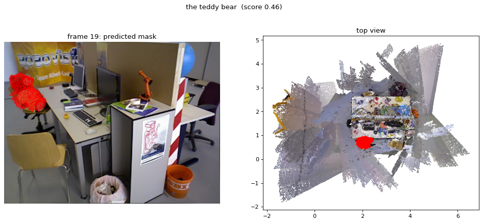

# Qwen-3D local inference

Run [Qwen-3D](https://qwen-3d.github.io) 3D grounding and question answering on your own scenes,
on a single 24 GB GPU (tested on an RTX 4090) with the 3B checkpoint. You don't need ScanNet:
a scene can come from posed RGB-D frames or from a plain video.

**License:** the scripts in this repo are MIT. The Qwen-3D weights are CC-BY-NC-4.0 and the
Qwen2.5-VL-3B backbone is under the Qwen Research License, so you can use them for research and
evaluation only, not commercially. The submodules keep their own licenses.

## Repository layout

| Path | What |
|---|---|
| `qwen3d/` | submodule: upstream [Qwen-3D](https://github.com/ll220/qwen3d), pinned |
| `third_party/map-anything/` | submodule: [MapAnything](https://github.com/facebookresearch/map-anything), pinned |
| `patches/` | the one change to upstream: `qwen3d/scripts/main_qwen.sh` honors env path overrides |
| `envs/*.lock.yml` | exact package versions of the two working conda envs (for reference) |
| `scripts/setup.sh` | submodules + patch + checkpoint download and sha256 check |
| `scripts/env.sh` | env activation + all paths; source it before anything in the `qwen3d` env |
| `scripts/prepare_scene.py` | posed RGB-D → ScanNet-style frames + fused pseudo-mesh, gravity-aligned |
| `scripts/video_to_rgbd.py` | video/images → posed metric RGB-D (MapAnything) |
| `scripts/demo_custom.py` | grounding / QA on a prepared scene |
| `scripts/smoke_load.py` | builds the model + loads the checkpoint |
| `scripts/run_eval_scannet.sh` | official ScanNet eval wrapper (only if you have ScanNet) |
| `scripts/record_session.sh`, `render_recording.py` | record and render the demo terminal session |

These folders are created locally and not tracked by git: `ckpts/`, `data/`, `outputs/` and `my_scenes/`.

## Setup

### 1. Clone and fetch the weights

    git clone --recursive https://github.com/liJanlong/qwen3d-local.git
    cd qwen3d-local
    pip install -U huggingface_hub          # provides the `hf` CLI
    bash scripts/setup.sh

`setup.sh` downloads `katefgroup/Qwen-3D/qwen3d_3b.pth` (7.4 GB) into `ckpts/` and checks its sha256.
The `Qwen/Qwen2.5-VL-3B-Instruct` backbone is fetched into the HF cache on first run.

### 2. `qwen3d` conda env (CUDA 12.9, torch 2.12.1)

Follow upstream's [installation](qwen3d/README.md#installation). In short:

    conda create -n qwen3d python=3.12 -y && conda activate qwen3d
    conda install cuda cuda-nvcc -c nvidia/label/cuda-12.9.0 -y
    export CUDA_HOME=$CONDA_PREFIX LD_LIBRARY_PATH=$CONDA_PREFIX/lib:$LD_LIBRARY_PATH
    export TORCH_CUDA_ARCH_LIST="8.9"       # your GPU's compute capability (8.9 = RTX 4090)
    pip install torch==2.12.1 torchvision==0.27.1 --index-url https://download.pytorch.org/whl/cu129
    pip install torch-scatter --no-build-isolation
    pip install 'git+https://github.com/facebookresearch/detectron2.git' --no-build-isolation
    pip install git+https://github.com/facebookresearch/pytorch3d.git@stable --no-build-isolation
    cd qwen3d && bash docs/init.sh && pip install -r requirements.txt && cd ..
    python -m spacy download en_core_web_sm
    python -c 'import nltk; nltk.download("stopwords")'

If something doesn't resolve, compare against `envs/qwen3d.lock.yml`. Then check that the model loads:

    source scripts/env.sh
    python scripts/smoke_load.py

`scripts/env.sh` puts the env's `bin/` first on `PATH` and sets `PYTHONNOUSERSITE=1`, which protects
against shells that put another env's binaries first. Set `TORCH_CUDA_ARCH_LIST` in it to your GPU.

### 3. `mapanything` conda env (only needed for video input)

    conda create -n mapanything python=3.12 -y && conda activate mapanything
    pip install torch==2.7.0 torchvision==0.22.0 --index-url https://download.pytorch.org/whl/cu126
    pip install -e third_party/map-anything

It uses the `facebook/map-anything-apache` weights, downloaded on first run.
Exact versions are in `envs/mapanything.lock.yml`.

## Usage

### 1. Get a scene

From a [TUM RGB-D](https://cvg.cit.tum.de/data/datasets/rgbd-dataset/download) sequence (real depth +
motion-capture poses), extracted into `data/raw/tum/`:

    source scripts/env.sh
    python scripts/prepare_scene.py --tum data/raw/tum/rgbd_dataset_freiburg3_long_office_household --scene tum_office

From a video or a folder of photos (any camera; MapAnything estimates metric depth + poses):

    PYTHONNOUSERSITE=1 conda run --no-capture-output -n mapanything \
        python scripts/video_to_rgbd.py my_scenes/room.mp4 my_scenes/room_rgbd
    source scripts/env.sh
    python scripts/prepare_scene.py --generic my_scenes/room_rgbd --scene room --num-frames 60

Prepared scenes go to `data/custom/` (`frames/`, `mesh/`).

Capture tips: walk slowly around the room, keep the camera roughly upright, and show the floor.
The floor is used to find "up".

### 2. Ask

    python scripts/demo_custom.py --scene tum_office --query "the teddy bear"
    python scripts/demo_custom.py --scene tum_office --question "What color is the dice on the desk?"

Grounding writes `outputs/demo/<scene>/<query>.png` (mask in the best visible frame + top view)
and a `.ply` with the object in red. If the auto-picked target noun is wrong, pass `--target "chair"`.
Add `--video` to also write an H.264 `.mp4`: a walkthrough of the input frames with the object
highlighted, then a 3D orbit around it (~16 s at 15 fps, ~25 MB).

## Results (TUM fr3/long_office_household)

| Input | Grounding (teddy bear, dice, globe, purple chair) | QA (dice color / thing on the chair) |
|---|---|---|
| Kinect depth + mocap poses, 90 frames | 4/4 correct | "yellow" / "yellow teddy bear" |
| RGB only → MapAnything, 60 frames | 3/4 (dice: empty mask) | — / "globe" (wrong) |

MapAnything depth vs the Kinect on this sequence: scale 0.885, 11.6% median abs-rel error.
Peak GPU memory: 16.3 GiB grounding, 12.8 GiB QA (90 frames).

## Credits

[Qwen-3D](https://qwen-3d.github.io), [MapAnything](https://github.com/facebookresearch/map-anything),
[Qwen2.5-VL](https://github.com/QwenLM/Qwen2.5-VL). Example image from the
[TUM RGB-D benchmark](https://cvg.cit.tum.de/data/datasets/rgbd-dataset) (CC BY 4.0).
